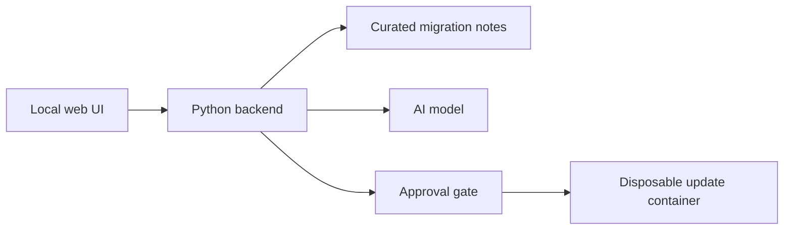

# Requirements

### Goal
Build a local hackathon prototype that helps employees move from Microsoft Excel to LibreOffice Calc, using their selected role and familiar Excel tasks to tailor onboarding and answer questions.

### Behavior
- Offer a few fictional employee roles and common spreadsheet tasks; generate a step-by-step, Excel-to-Calc onboarding guide and allow follow-up questions.
- Ground responses in a small curated set of attributed migration notes. Show source links and acknowledge when the material does not support an answer.
- Demonstrate a separate package-update recommendation with a clear target, current and proposed versions, and an approval request. Only an authorized demo administrator can approve execution.
- Run one real, fixed, allowlisted `certifi` upgrade inside a disposable isolated container; report success or failure and never modify the host or employee devices. Treat it as a demo update, not a confirmed security exploit.

### Boundaries
No live company integrations, employee behavior monitoring, document upload, autonomous execution, vulnerability scanning, real device management, multi-tenant support, or production deployment. Employee profiles and session data are fictional and temporary.

# Technical Design

### Current state and choices
- `README.md` contains only the project title; there is no application or comparable implementation. `.idea/misc.xml` points to a Python virtual environment, and `lauzhack.venv/pyvenv.cfg` specifies Python 3.13.9; that environment currently has no `pip`.
- Build a single Python backend with FastAPI and a small server-served HTML/JavaScript UI. Declare reproducible dependencies in `pyproject.toml`; document a supported install path rather than relying on the existing environment.
- Use a configurable OpenAI-compatible model client with an environment-supplied key and model identifier. If configuration or the provider is unavailable, show an actionable error instead of fabricating an AI response. Demo inputs must not contain confidential company information.
- Keep role selection, conversation history, and update requests in short-lived in-memory sessions; a server restart clears them. Present the demo as local-only, not production authentication.

### Application flow
Load the short curated knowledge corpus into the model context on each guide or question request, together with the selected role and limited session history. Ask for task-focused steps and references to provided source identifiers; render only valid source links from the server-side corpus. For unsupported questions, instruct the model to say it lacks enough information. Include official sources such as the [LibreOffice Calc formulas and functions guide](https://books.libreoffice.org/en/CG248/CG24809-FormulasAndFunctions.html), noting the version of each source.

The update is a fixed demo scenario, not an LLM-generated command or an inference about the user's machine. A server-owned catalog defines the package, exact baseline and target versions, and explanation. Approval is bound to the specific pending request and session, requires a separately configured administrator secret, and is consumed at most once. Missing credentials, invalid approval, duplicate requests, and unavailable Docker must fail closed.

Build a dedicated Docker image containing the pinned baseline and target wheels. On approval, run the prebuilt image with fixed arguments and no shell, host mounts, network, privileges, or writable root filesystem; allow only a bounded temporary writable area for a non-root demo environment, and impose execution time and resource limits. Install the preloaded baseline, perform the offline upgrade to the pinned target, and verify/report the resulting version. Never expose a general command runner or allow model/user text to select commands, images, packages, or versions. Run the server on loopback; protect state-changing requests against cross-origin use and keep the administrator secret out of logs.

### Contracts
- `POST /api/session`: create a session and select a predefined employee role; return the role and session context.
- `POST /api/guide`: generate a cited onboarding guide for the selected role and task.
- `POST /api/chat`: answer a follow-up using that session's context and known sources.
- `POST /api/updates/proposals`: create the single catalog-backed pending update with immutable package/version details.
- `POST /api/updates/{id}/approve`: authenticate the demo administrator and atomically consume that session's pending proposal; return execution status and verified version or a safe failure. Session identity is carried by an opaque, HTTP-only, same-site cookie; request bodies never contain executable commands.

### File structure
- `pyproject.toml`: Python dependencies and test configuration.
- `app/main.py`, `app/models.py`, `app/sessions.py`: routes, request/response models, and in-memory session state.
- `app/knowledge.py`, `app/assistant.py`, `app/data/migration.json`: curated roles and source-backed notes, model integration, and answer grounding.
- `app/updates.py`, `demo/update/Dockerfile`, `demo/update/run_update.py`: fixed update catalog, approval/execution handling, and offline isolated demonstration.
- `app/static/`: onboarding, chat, approval UI, and styles served by the backend.
- `tests/`: API, grounding, approval, and isolated-update coverage.
- `README.md`: installation, model and admin configuration, Docker prerequisites, demo walkthrough, limitations, and cleanup.

### Architecture

### Risks
Model responses may still contain mistakes despite grounding; show sources and avoid claiming unsupported compatibility. Docker is a demo isolation boundary, not a substitute for production endpoint management. Building the demo image requires fetching pinned artifacts, while the actual approved update runs offline.

# Testing

### Validation
- Use mocked model responses to verify role/task context, source rendering, follow-up history, unsupported-answer behavior, and clear provider configuration or availability errors.
- Exercise session isolation and expiration, including requests without a valid session and cross-origin state-changing requests.
- Test approval required, wrong or missing administrator secret, proposal/session mismatch, repeated approval, concurrent approval, timeout, and Docker failure; assert that none can execute a host command.
- Mock the subprocess boundary in automated tests to verify the fixed image, arguments, isolation flags, and absence of user/model-supplied commands. Where Docker is available, run an opt-in integration test that checks the pinned baseline and target versions inside a disposable container and confirms cleanup.
- Run the documented local demo flow: select a role, generate a cited guide, ask a follow-up, review the update, approve it, and inspect its verified result.

# Delivery Steps

### ✓ Step 1: Create the demo foundation and migration knowledge
The backend serves a local demo with curated Excel-to-Calc context and isolated session state.
- Add `pyproject.toml` and the minimal FastAPI application structure.
- Define fictional roles, common tasks, and a small attributed migration corpus with source versions and links.
- Add session creation and request validation, plus tests for role selection and session isolation.

### ✓ Step 2: Implement personalized onboarding and questions
Employees can generate a sourced migration guide and ask contextual follow-up questions.
- Implement the configurable model client, prompt construction, bounded conversation history, and source-ID validation in `app/assistant.py`.
- Add guide and chat endpoints using the curated context, with explicit provider-error and unsupported-answer behavior.
- Test generated-response handling with a mocked provider, including citations and failure cases.

### ✓ Step 3: Add the approval-gated isolated update
An administrator can approve one fixed package update that runs only in a disposable container.
- Implement the immutable update catalog, session-bound pending proposals, administrator authentication, and single-use approval in `app/updates.py`.
- Create the pinned offline demo image and fixed, resource-limited non-root execution path; verify and report the installed version.
- Test authorization, replay and concurrency protection, subprocess isolation arguments, and execution failures; add an opt-in Docker integration test.

### ✓ Step 4: Connect the demo interface and document operation
The complete local walkthrough exposes onboarding, chat, and the approval workflow with clear status and limitations.
- Build the served UI for role/task selection, cited guides, follow-up questions, proposal review, administrator approval, and execution results.
- Enforce loopback and cross-origin safeguards for the local demo and avoid exposing secrets in logs.
- Document Python setup, model credentials, image build, Docker requirements, walkthrough, failure handling, and cleanup in `README.md`; exercise the end-to-end flow.